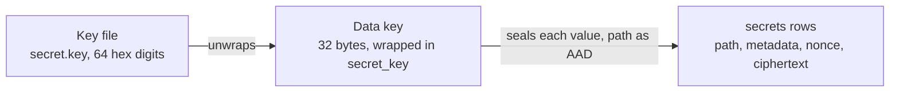

# Secret store

Code: `crates/giles-core/src/secrets/` (`giles_core::secrets`), with its rows in `giles-store`
([Storage](storage.md#secrets)). Design: PLAN section 7.7 and the decisions on
[#29 Secrets storage](https://github.com/jennings/giles/issues/29).

The secret store holds named credentials that the core injects into the components using them.
Nothing reads from it yet. `{ secret = "name" }` references still resolve against `secrets.toml`
([Configuration](config.md#secrets)) until the reference, management, and migration work lands.

## Paths

A secret's name is a `SecretPath`: lowercase slash-separated segments of `a-z`, `0-9`, `-`, `_`, and
`.`, each starting with a letter or digit, at most 255 bytes. No segment is empty, so there's no
leading, trailing, or doubled `/`. Paths are valid Vault paths as written.

- `users/<user>/…` is a user's personal space, and `SecretPath::owner` returns `<user>`.
- `users` and `users/<user>` themselves are refused as secrets, so a personal space is never also a
  secret's name.
- A path prefix is a group. `list(Some("ssh"))` returns `ssh/prod`, not `ssh` or `ssh-old/a`.

Paths aren't sensitive. They appear in errors, logs, and config.

## Provider interface

`SecretProvider` is an async, object-safe trait. `Runtime::secrets` holds one as
`Arc<dyn SecretProvider>`.

| Method                         | Contract                                                        |
| ------------------------------ | --------------------------------------------------------------- |
| `get(path)`                    | The value, as a redacting `Secret`. The only way to a value, for the core's injection only. |
| `metadata(path)`               | `SecretMetadata`: path, description, created and updated, each with the user or `None`. |
| `list(under)`                  | Metadata below `under/`, or of every secret, ordered by path.   |
| `put(path, value, by)`         | Creates the secret with an empty description, or replaces the value and keeps the description. |
| `describe(path, description, by)` | Changes only the description. `NotFound` if there's no secret. Values are write-only, so metadata changes can't need the value. |
| `delete(path)`                 | `false` if there was none.                                      |

`SecretError` separates `NotFound`, `Damaged` (a stored value that won't open), and `Unavailable`
(the backend failed). A remote provider's outage is therefore never reported as a missing secret. No
error carries a value.

Providers don't check permissions. The ACL from
[#67 Secret ACL model](https://github.com/jennings/giles/issues/67) is enforced by the core above
the trait, so a Vault provider sees only Giles.

Later providers implement the same trait:

- HashiCorp Vault, as a built-in provider.
- `giles-secret-*` plugins, through an adapter that implements the trait over gRPC, as
  `RemoteChannel` does for channels.

A Windows DPAPI, passphrase, or Keychain key would be another key source of the local store, not a
provider.

## Local store

`LocalSecrets` keeps one row per secret in `giles.db` (`secrets`). The path and metadata are plain,
so listing and ACL checks never need a key. Only the value is sealed.

- **Cipher.** AES-256-GCM from `aws-lc-rs`, which rustls already builds. `RandomizedNonceKey` draws
  a random 96-bit nonce for every seal, and Giles makes one seal per secret write, far below the
  2^32 limit per key. Each row and the wrapped key record `aes-256-gcm`, so a later cipher is a
  re-encrypt migration.
- **Associated data.** A value's AAD is its path, so a ciphertext copied onto another row fails to
  open (`Damaged`). The data key's AAD is `giles:secret-store:data-key`. Paths can't contain `:`, so
  neither opens as the other.
- **Two levels of key.** One random data key seals every row. The `secret_key` row holds it sealed
  by the key-encryption key from the key source, with the source's kind (`key-file`). Changing key
  source re-wraps 32 bytes and leaves the rows alone.
- **Key material in memory.** Raw key bytes are `zeroize::Zeroizing` and wiped on drop. `aws-lc-rs`
  wipes its own key schedule. A decrypted value becomes a `Secret`, whose `Debug` and `Display`
  print `<redacted>`.

### Key file

`KeyFile::new(root, path)` is the file at `core.secret_key_file`, by default `<root>/secret.key`. A
relative setting resolves against the data root. The file holds 64 hex digits
(`openssl rand -hex 32` makes one), and surrounding whitespace is ignored. Reading refuses a file
that isn't regular or doesn't hold exactly 64 hex digits. No message quotes the file.

- **Mode.** Inside the data root, the file must have no group or other bits, as `secrets.toml` must
  not. Outside it, whatever mounts the file owns its mode. systemd credentials are 0400, and Docker
  Compose bind-mounts secrets with the host file's mode.
- **Creation.** Giles creates the file only at the default location, with `create_new` and mode
  0600, so it never overwrites one. A configured file that doesn't exist is `KeyError::NotCreated`,
  whatever the database holds. A typo in the setting therefore can't produce a fresh key.

The setting serves keys that live off the data disk. `$CREDENTIALS_DIRECTORY/<name>`, from
`LoadCredentialEncrypted=`, is a `systemd-creds` credential, TPM2-bound if the host has a TPM. A
`/run/secrets/<name>` file comes from an orchestrator. Giles reads one file either way.

### Opening at startup

`Runtime::start` calls `LocalSecrets::open` right after the database opens. A failure is
`StartError::Secrets` and stops startup.

| Key file | Stored data key | Secrets stored | Result |
| -------- | --------------- | -------------- | ------ |
| present  | unwraps         | any            | Opens. |
| present  | none            | none           | New data key, wrapped and stored. |
| missing  | none            | none           | Creates the default key file, then a new data key. |
| missing  | present         | none           | Warns, creates the default key file, makes a new data key. |
| missing, configured | any  | any            | Refuses: `KeyError::NotCreated`. |
| present  | doesn't unwrap  | none           | Warns, makes a new data key. |
| missing  | present         | some           | Refuses: `KeyError::Missing`. Nothing is created. |
| present  | doesn't unwrap  | some           | Refuses: `KeyError::WrongKey`. Nothing changes. |

The data key may change only while no secret is stored. `secret_data_key_set` checks that in the
same transaction as the write. An empty store has nothing to lose, so a database restored without
its key file starts with a fresh key instead of refusing. Once a secret exists, Giles never makes a
new key over it.

### Reach

- `secret.key` and `giles.db` sit in the data root, which no plugin sandbox grant may overlap
  ([Plugin sandbox](sandbox.md)). A configured key file anywhere else is protected the same way: no
  grant may be it or contain it, and the instance's own data directory is no exception
  ([Configuration](config.md#sandbox-grants)).
- `giles backup` copies only an explicit list of files, which leaves out `secret.key`
  ([Backups](backups.md)). A backup carries ciphertext only.
- With the default key file, theft of the whole disk exposes the secrets. A TPM-bound
  `systemd-creds` credential, a passphrase, or full-disk encryption covers that.
